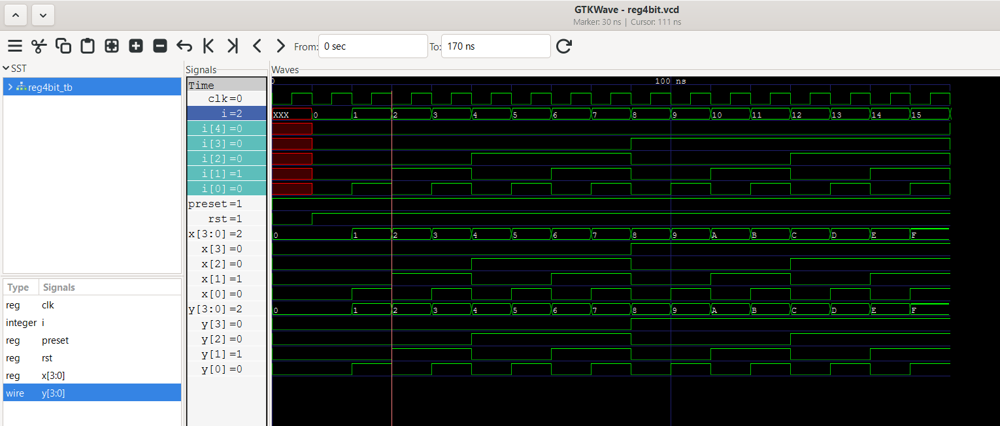
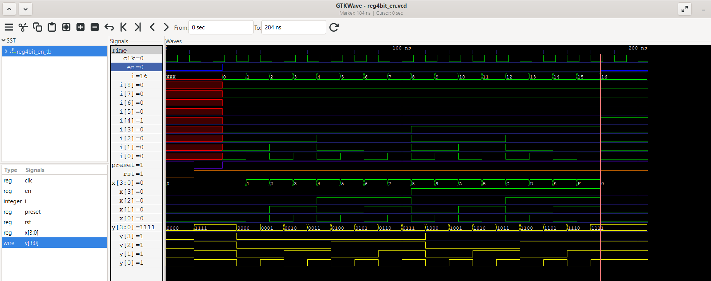

## Working Theory
## NO OF FLIP-FLOPS = NO OF BITS STORED
A 4-bit register stores 4 bits of binary data.

- It consists of four flip-flops.
- All flip-flops share a common clock.
- Data is stored on the negative clock edge.
- Reset clears the register to 0000.
- Preset sets the register to 1111.

## Waveform

The following waveform shows the operation of the 4-bit register,
including clock, reset, preset, input and output signals.

# 4-Bit Register with Enable

## Overview
A 4-bit register with enable is a sequential digital circuit that stores 4 bits of data. It updates its output only when the enable signal is HIGH.

When the enable signal is LOW, the register holds its previous value.

## Features
- 4-bit data storage.
- Positive-edge-triggered clock.
- Active-low asynchronous reset.
- Enable control.
- Active-low asynchronous preset.
- Holds the previous value when enable is LOW.

## Working Principle

| Reset | Preset | Enable | Operation |
|:---:|:---:|:---:|---|
| 0 | X | X | Reset output to `0000` |
| 1 | 0 | X | Preset output to `1111` |
| 1 | 1 | 1 | Load input data |
| 1 | 1 | 0 | Hold previous value |

**Note:** Reset and preset are active LOW. Reset has priority over preset in this implementation.

## Verilog Concepts Used
- `always` block
- Non-blocking assignment (`<=`)
- Clock edge triggering (`posedge`)
- Asynchronous reset and preset
- Conditional statements (`if-else`)
- 4-bit registers

## Simulation
The testbench verifies:
1. Asynchronous reset.
2. Asynchronous preset.
3. Loading data when enable is HIGH.
4. Holding the previous value when enable is LOW.
5. Register operation over multiple clock cycles.

## Tools Used
- Verilog HDL
- Icarus Verilog
- GTKWave

## Learning Outcome
Implemented and simulated a 4-bit enabled register using Verilog HDL and understood how enable control allows a register to load new data or retain its previous value.

THIS SHOWS THE WAVEFORM FOR THE 4-BIT REGISTER WITH ENABLE INPUT.
