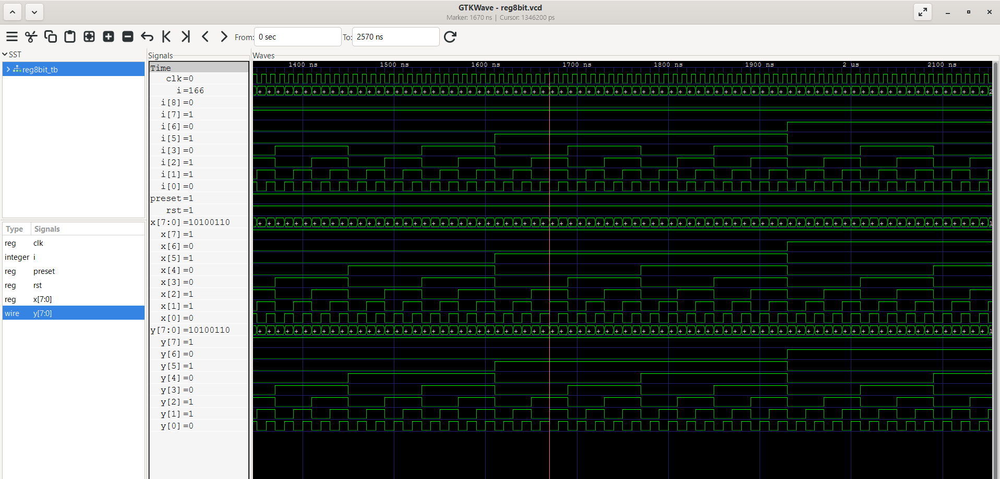

## Working Theory
## AS , NO OF BITS STORED = NO OF FLIP FLOPS USED , HENCE....
A 8-bit register stores 8 bits of binary data.

- It consists of eight flip-flops.
- All flip-flops share a common clock.
- Data is stored on the negative clock edge.
- Reset clears the register to 00000000.
- Preset sets the register to 11111111.

## Waveform

The following waveform shows the operation of the 8-bit register,
including clock, reset, preset, input and output signals.

